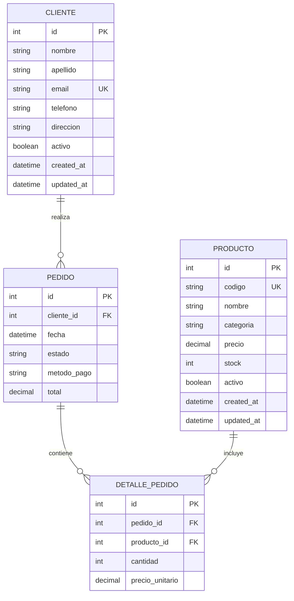

# Diagrama de base de datos - Proyecto Django

## Modelo conceptual

Cliente 1 --- * Pedido
Pedido 1 --- * DetallePedido
Producto 1 --- * DetallePedido

## Diagrama Mermaid

## Relación entre tablas

- Un Cliente puede tener muchos Pedidos.
- Un Pedido pertenece a un Cliente.
- Un Pedido puede tener muchos Detalles de Pedido.
- Un Producto puede estar en muchos Detalles de Pedido.
- Un DetallePedido pertenece a un Pedido y a un Producto.

## Claves y atributos principales

- Cliente: id, nombre, apellido, email, telefono, direccion, activo.
- Producto: id, codigo, nombre, categoria, precio, stock, activo.
- Pedido: id, cliente_id, fecha, estado, metodo_pago, total.
- DetallePedido: id, pedido_id, producto_id, cantidad, precio_unitario.

## Correspondencia con Django

Este diagrama corresponde directamente a los modelos:
- Cliente
- Producto
- Pedido
- DetallePedido
