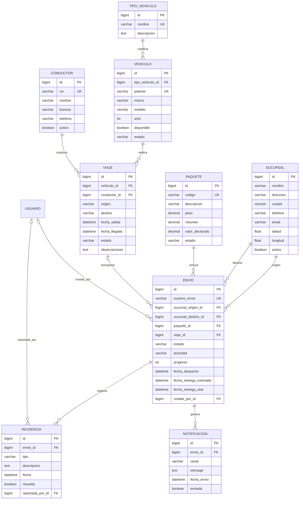

# Music Pro Courier: Evaluación 3, aplicación web con CRUD

Sistema web administrativo hecho en **Django** y **MySQL** para la logística de **Music Pro Tour**. Gestiona los envíos de instrumentos entre sucursales y los recursos de transporte (vehículos, conductores y viajes).

Este proyecto **continúa el caso de la Evaluación 2** (Django Admin). En la Evaluación 3 se reemplazó Django Admin por un **administrador propio**, con autenticación, control de acceso con decoradores, mantenedores CRUD, mantención de usuarios y una página de **reportes construidos con el ORM**.

> **Proyecto del informe ORM:** _Transporte_ (vehículos, conductores y viajes). Encaja de forma natural en un courier: cada envío viaja en un viaje que tiene un vehículo y un conductor asignados.

---

## 1. Cumplimiento de la pauta

### Parte 1: Sistema web administrativo

| Requisito del docx | Cómo se cumple | Dónde |
|---|---|---|
| Conexión con MySQL local | Motor `django.db.backends.mysql` con credenciales leídas desde `.env` | `musicpro/settings.py` |
| Autenticación (inicio y cierre de sesión) | `LoginView` / `LogoutView` de `django.contrib.auth` con plantillas propias | `courier/views/cuentas.py`, `templates/registration/` |
| Control de acceso con decoradores | `@login_required` en **todas** las vistas privadas; `@administrador_requerido` para usuarios | `courier/views/*.py`, `courier/decorators.py` |
| Protección de funcionalidades | Sin sesión, cualquier URL privada redirige al login (también los POST y los JSON) | Tests en `courier/tests/test_autenticacion.py` |
| Mantención de usuarios | Crear, listar, buscar, editar, cambiar clave, **desactivar/activar** y eliminar | `courier/views/usuarios.py` |
| Mantención de entidades del caso | CRUD de Sucursales, Paquetes, Envíos, Incidencias, Notificaciones, Tipos de vehículo, Vehículos, Conductores y Viajes | `courier/views/gestion.py` |
| Uso del ORM | Todas las consultas usan el ORM (`filter`, `annotate`, `aggregate`, `Q`, `F`, `Count`, `Avg`, `Case/When`, subconsultas). **No hay SQL escrito a mano** | `courier/views/`, `courier/reportes.py` |
| Interfaz web funcional | Panel con menú lateral, listados con búsqueda, filtros y paginación, formularios validados y detalle de envíos y viajes | `templates/` |
| Persistencia de datos | Cada operación de la interfaz se refleja en MySQL (verificado con tests contra MySQL) | `courier/tests/test_crud.py` |
| **Sin Django Admin** | `django.contrib.admin` fue retirado de `INSTALLED_APPS` y de las URLs | `musicpro/settings.py`, `musicpro/urls.py` |

### Énfasis de la evaluación: autenticación y seguridad

| Lo que hay que demostrar | Cómo verlo en la aplicación |
|---|---|
| 1. Iniciar sesión correctamente | `/cuentas/login/` → redirige a `/panel/` con un mensaje de bienvenida |
| 2. Cerrar sesión | Botón **Cerrar sesión** (formulario POST con token CSRF) |
| 3. Vistas protegidas con decoradores | `@login_required` sobre cada vista; ver `courier/views/gestion.py` |
| 4. Sin sesión no se entra escribiendo la URL | Abrir `/vehiculos/` en una ventana privada → login con aviso "Debe iniciar sesión" |
| 5. Tras cerrar sesión se pierde el acceso | Cerrar sesión y presionar "Atrás": la página no sale del caché (cabecera `no-store`) y pide login |
| 6. La sesión identifica al usuario | **Mi perfil** muestra el usuario de la sesión, la hora de inicio, el acceso anterior y la expiración. Envíos e incidencias guardan qué usuario los registró |

### Parte 2: Consultas con Django ORM

La página **Reportes ORM** (`/reportes/`) tiene los **20 reportes** del proyecto Transporte, agrupados por nivel. Así, cualquier selección de 10 consultas que entregue el docente ya está implementada. Cada reporte muestra:

- el **resultado** en una tabla (y un gráfico cuando corresponde),
- el **código ORM** exacto que se ejecutó (se lee desde `courier/reportes.py`),
- el **SQL que generó Django** a partir de ese código, como evidencia.

| N.º | Nivel | Pregunta | Técnica ORM principal |
|---|---|---|---|
| 1 | Básico | ¿Cuáles son todos los vehículos registrados? | `select_related`, `order_by` |
| 2 | Básico | ¿Qué vehículos pertenecen a un tipo seleccionado? | `filter(tipo_vehiculo=...)` |
| 3 | Básico | ¿Qué vehículos están disponibles? | `filter(disponible=True)` |
| 4 | Básico | ¿Cuáles son los 10 vehículos más antiguos? | `order_by('anio')[:10]` |
| 5 | Básico | ¿Cuántos conductores hay registrados? | `aggregate(Count, filter=Q)` |
| 6 | Intermedio | Viajes de un vehículo específico | `filter(vehiculo=...)` |
| 7 | Intermedio | Viajes asignados a un conductor | `filter(conductor=...)` |
| 8 | Intermedio | Viajes por estado | `values_list().annotate(Count)` |
| 9 | Intermedio | Viajes en un rango de fechas | `fecha_salida__gte / __lt` |
| 10 | Intermedio | Vehículos sin viajes | `filter(viajes__isnull=True)` |
| 11 | Intermedio | Top 5 conductores con más viajes | `annotate(Count('viajes'))[:5]` |
| 12 | Intermedio | Top 5 vehículos con más viajes | `annotate(Count('viajes'))[:5]` |
| 13 | Avanzado | Viajes por conductor en el último mes | `Count('viajes', filter=Q(...))` |
| 14 | Avanzado | Tipos de vehículo más usados | `Count('vehiculos__viajes')` |
| 15 | Avanzado | Viajes por destino | `values('destino').annotate()` |
| 16 | Avanzado | Conductores sin viajes en un período | `exclude(id__in=subconsulta)` |
| 17 | Avanzado | Duración promedio de viajes finalizados | `Avg(F('fecha_llegada') - F('fecha_salida'))` |
| 18 | Análisis | Conductor con más viajes finalizados en el año | `Count(filter=Q(... __year=))` |
| 19 | Análisis | % finalizados, cancelados y pendientes | `aggregate` + cálculo de porcentajes |
| 20 | Análisis | Distribución mensual de viajes en un año | Agregación condicional con 12 `Count(filter=Q)` |

> Los rangos de fechas se calculan en Python con la zona horaria de Chile y se filtran con `__gte` / `__lt`. Así los reportes funcionan aunque MySQL no tenga cargadas las tablas de zonas horarias, que es lo habitual en Windows.

---

## 2. Panel de control y gráficos

El panel (`/panel/`) toma como guía de contenido la imagen de referencia del docx (indicadores, viajes por estado, viajes por tipo de vehículo, evolución, top 5 de conductores y últimos viajes), pero con un **diseño propio y distinto**:

| Contenido de la referencia | Cómo se muestra en este proyecto |
|---|---|
| Selector "Período" | Control segmentado: 7 días · 30 días · 90 días · 12 meses. Filtra **todo** el panel |
| Tarjetas de indicadores | Franjas de indicadores con variación frente al período anterior (flecha y signo, no solo color) y un minigráfico de tendencia |
| Dona "Viajes por estado" | **Barra segmentada** con el % de cada estado, leyenda con iconos y tabla equivalente |
| Barras verticales por tipo de vehículo | **Barras horizontales** ordenadas de mayor a menor, con el valor en la punta |
| Línea "Evolución de viajes" | **Columnas** por día, semana o mes, a todo el ancho, con eje y líneas guía finas. Se rotulan solo el máximo y el último valor |
| Tabla "Top 5 conductores" | **Medidores** horizontales con posición, viajes y % de participación |
| Tabla "Últimos viajes" | **Línea de tiempo** con el estado de cada viaje |

Los gráficos están hechos con HTML y CSS propios, sin librerías de gráficos. Cada uno tiene un tooltip (con mouse o teclado) y un botón **"Ver como tabla"**. Los colores de los estados se validaron para personas con daltonismo y para el contraste sobre el fondo oscuro. Todos los datos salen de consultas ORM con agregación condicional (`Count(..., filter=Q(...))`), una consulta por gráfico.

## 3. Modelo de datos



**Integridad referencial:** las relaciones usan `on_delete=PROTECT`. Si un vehículo, conductor o sucursal tiene registros asociados, no se puede eliminar: la interfaz lo informa y recomienda marcarlo como inactivo.

---

## 4. Estructura del proyecto

```text
musicpro/                 Configuración del proyecto (settings, urls, wsgi)
courier/
    models.py             Modelos del courier y del transporte
    forms.py              ModelForms con validaciones (RUT, patente, fechas)
    validators.py         Validación de RUT (módulo 11) y patentes chilenas
    decorators.py         @administrador_requerido
    middleware.py         Sin caché para usuarios autenticados
    reportes.py           Las 20 consultas ORM del informe
    graficos.py           Datos de los gráficos (proporciones, escalas, variaciones)
    views/
        publico.py        Página pública
        cuentas.py        Login, logout y cambio de contraseña
        panel.py          Dashboard, seguimiento, perfil y JSON
        gestion.py        CRUD de las 9 entidades
        usuarios.py       Mantenedor de usuarios
        reportes.py       Página de reportes (resultado + código + SQL)
        utils.py          Paginación y helpers de crear/editar/eliminar
    management/commands/seed_courier.py   Datos de prueba con Faker
    migrations/
    tests/                Pruebas automáticas (60)
templates/                Plantillas (base con menú lateral, CRUD, reportes)
static/                   CSS, JS (tooltips) y librerías locales (Bootstrap, Font Awesome)
docs/GUIA_DEFENSA.md      Guía para explicar el proyecto en la defensa
Ejercicios/               Ejercicios de clase (proyecto independiente)
```

---

## 5. Instalación y ejecución (Windows)

### 5.1 Requisitos

- Python 3.12 o superior
- MySQL Server **8.4 o superior** (o MariaDB 10.11+), corriendo en local
  - Si tiene MySQL 8.0, instale Django 5.2 LTS: `pip install "Django>=5.2,<6.0"`

### 5.2 Clonar e instalar dependencias

```bash
git clone https://github.com/maxsteel19/musicpro-courier.git
cd musicpro-courier
python -m venv env
env\Scripts\activate
pip install -r requirements.txt
```

### 5.3 Crear la base de datos en MySQL

Desde MySQL Workbench o la consola `mysql -u root -p`:

```sql
CREATE DATABASE musicpro_courier CHARACTER SET utf8mb4 COLLATE utf8mb4_unicode_ci;
-- (Opcional, recomendado) usuario propio en vez de root:
CREATE USER 'musicpro'@'localhost' IDENTIFIED BY 'una-clave-segura';
GRANT ALL PRIVILEGES ON musicpro_courier.* TO 'musicpro'@'localhost';
GRANT ALL PRIVILEGES ON test_musicpro_courier.* TO 'musicpro'@'localhost';  -- para los tests
FLUSH PRIVILEGES;
```

### 5.4 Configurar las credenciales

Copie `.env.example` como `.env` y complete los datos de su MySQL:

```bash
copy .env.example .env
```

```ini
DB_ENGINE=mysql
DB_NAME=musicpro_courier
DB_USER=musicpro
DB_PASSWORD=una-clave-segura
DB_HOST=127.0.0.1
DB_PORT=3306
```

El archivo `.env` está en `.gitignore`: las claves nunca se suben a GitHub.

### 5.5 Migrar, cargar datos y crear el administrador

```bash
python manage.py migrate
python manage.py seed_courier
python manage.py createsuperuser
python manage.py runserver
```

- Sitio público: http://127.0.0.1:8000/
- Login: http://127.0.0.1:8000/cuentas/login/
- Panel: http://127.0.0.1:8000/panel/

`seed_courier` carga 8 sucursales, 5 tipos de vehículo, 22 vehículos, 16 conductores, unos 650 viajes repartidos en los últimos 14 meses, 300 paquetes, 300 envíos, incidencias y notificaciones. Use `python manage.py seed_courier --limpiar` para regenerarlos.

### 5.6 Roles

| Rol | Cómo se obtiene | Acceso |
|---|---|---|
| Superusuario | `createsuperuser` | Todo, incluida la administración de otros superusuarios |
| Administrador | Usuario con "Administrador del sistema" marcado (`is_staff`) | Todo el sistema y la mantención de usuarios |
| Operador | Usuario normal | Panel, CRUD de entidades y reportes; **no** ve la mantención de usuarios (recibe 403) |

---

## 6. Pruebas automáticas

```bash
python manage.py test courier
```

Son 60 pruebas que verifican, entre otras cosas:

- login correcto e incorrecto, usuario desactivado, parámetro `next` seguro y cambio de id de sesión,
- que **todas** las URLs privadas redirigen al login sin sesión, y que un POST sin sesión no modifica la base,
- que el logout solo acepta POST y quita el acceso,
- la mantención de usuarios y sus restricciones (operador = 403, no auto-desactivarse, etc.),
- crear, editar y eliminar cada una de las 9 entidades, y que el cambio quede en la base de datos,
- las validaciones (RUT, patente, fechas, origen ≠ destino, registros protegidos),
- los 20 reportes y la exactitud de sus resultados,
- los cálculos de los gráficos y el panel en cada período (7 días, 30 días, 90 días y 12 meses).

Para correrlas sin MySQL (por ejemplo, en otro computador): `set DB_ENGINE=sqlite` y luego el mismo comando.

---

## 7. Seguridad aplicada

- Contraseñas guardadas con hash (PBKDF2 de Django) y validadores de largo mínimo, contraseñas comunes, solo números y similitud con el usuario.
- Protección **CSRF** en todos los formularios. El logout y la desactivación de usuarios solo aceptan POST.
- Al iniciar sesión, Django **renueva el id de sesión** (evita la fijación de sesión).
- Sesión con expiración por inactividad (1 hora) y al cerrar el navegador. Cookies `HttpOnly` y `SameSite=Lax`, y `Secure` cuando `DEBUG=False`.
- Las páginas privadas se envían con `Cache-Control: no-store`: tras el logout, "Atrás" no muestra datos.
- Control de acceso por rol: solo los administradores gestionan usuarios, y solo un superusuario puede modificar a otro superusuario. Nadie puede desactivarse ni quitarse su propio rol.
- La redirección `next` del login solo acepta URLs del propio sitio (evita redirecciones abiertas).
- La clave secreta y las credenciales de la base van en `.env`, no en el código. Con `DEBUG=False`, el sistema exige `DJANGO_SECRET_KEY`.
- El ORM parametriza todas las consultas, lo que previene inyección SQL. Las plantillas escapan HTML, y el tooltip de los gráficos inserta los textos con `textContent`.

---

## 8. Uso de inteligencia artificial como apoyo

Se usó un asistente de IA (Claude) para analizar el enunciado, proponer la estructura, generar y revisar código, y sugerir medidas de seguridad. Las recomendaciones se evaluaron antes de aplicarlas:

| Recomendación | Decisión |
|---|---|
| Proteger las vistas con `@login_required` y crear un decorador propio para el rol administrador | Aplicada |
| Cerrar sesión solo por POST con CSRF | Aplicada (además, Django 5+ lo exige) |
| Encabezados `no-store` para que "Atrás" no muestre páginas privadas tras el logout | Aplicada (middleware) |
| Credenciales en variables de entorno / `.env` | Aplicada, con un lector de `.env` sin dependencias extra |
| Usar `PROTECT` en las claves foráneas en vez de `CASCADE` | Aplicada: evita borrar envíos al eliminar una sucursal |
| Usar `__date` / `TruncMonth` para agrupar por fecha | **Descartada**: en MySQL sin tablas de zona horaria devuelven `NULL`. Se reemplazó por rangos `__gte/__lt` y agregación condicional |
| Bloquear cuentas tras varios intentos fallidos de login (`django-axes`) | **No aplicada**: suma una dependencia y configuración fuera del alcance. Queda como mejora futura |
| Usar vistas basadas en clases genéricas para todo el CRUD | **Descartada** en favor de funciones con decoradores, que dejan explícito el control de acceso que pide la pauta |

---

## 9. Evaluación anterior

La Evaluación 2 (Django Admin) sigue disponible en el historial de Git (commit `89bb814`). Desde la Evaluación 3, la administración se hace solo con el sistema propio.

## Autor

Pablo Martínez, Programación Backend.
