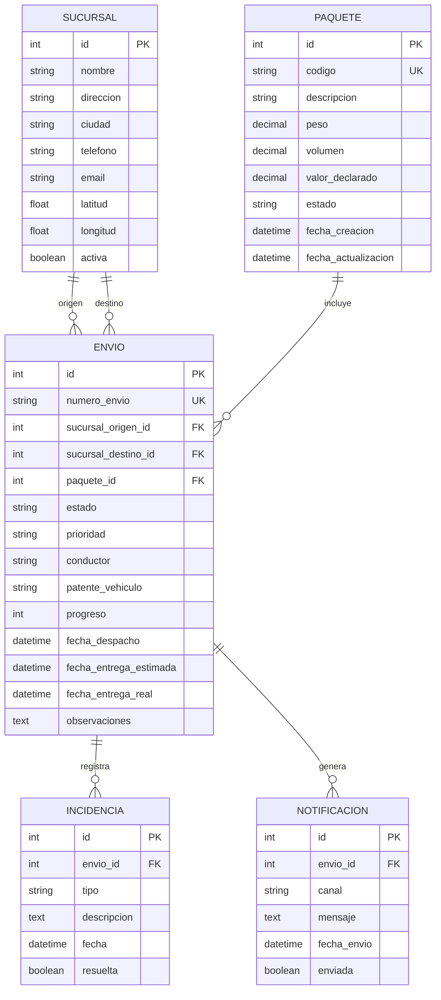

# Evaluación 2 - Aplicación web con Django Admin

## 1. Descripción general

Este proyecto corresponde a la Evaluación 2, en la cual se desarrolla una aplicación web con Django, configurando una base de datos, gestionando su estructura mediante migraciones, modelando entidades y administrándolas desde Django Admin.

La solución implementada busca resolver la gestión de operaciones logísticas y de distribución para Music Pro Tour, centrada en sucursales, paquetes, envíos, incidencias y notificaciones.

## 2. Objetivo

Desarrollar una aplicación backend con Django que permita:

- configurar la conexión a la base de datos,
- modelar correctamente las entidades y sus relaciones,
- generar y aplicar migraciones,
- administrar registros desde el panel de Django Admin,
- implementar operaciones CRUD,
- aplicar filtros y búsquedas,
- cargar datos de prueba para validar el sistema.

## 3. Requisitos evaluados

### 3.1 Configuración de la base de datos
La aplicación utiliza SQLite como motor de base de datos y está conectada mediante la configuración de Django en `musicpro/settings.py`.

### 3.2 Modelamiento de datos
Se implementaron modelos para representar la información principal del sistema:

- `Sucursal`
- `Paquete`
- `Envio`
- `Incidencia`
- `Notificacion`

Cada uno cuenta con atributos, tipos de datos y relaciones que permiten mantener la integridad de la información.

### 3.3 Migraciones
Las migraciones se gestionan con Django y se encuentran en la carpeta `courier/migrations`. Esto permite llevar el historial de cambios de la estructura de la base de datos.

### 3.4 Django Admin
Se registraron los modelos en `courier/admin.py`, permitiendo:

- crear registros,
- consultar información,
- editar datos,
- eliminar registros,
- filtrar por estado y otros criterios,
- realizar búsquedas rápidas.

### 3.5 CRUD
La aplicación permite realizar operaciones básicas de creación, lectura, actualización y eliminación sobre los datos del sistema.

### 3.6 Generación de datos de prueba
Se incorporó una carga de datos ficticios con Faker para validar la aplicación con registros realistas.

## 4. Diagrama de base de datos



## 5. Estructura del proyecto

```text
musicpro/
    settings.py
    urls.py
    wsgi.py

courier/
    admin.py
    models.py
    views.py
    urls.py
    migrations/
    management/
        commands/
            seed_courier.py

templates/
    courier/

static/
    css/

manage.py
README.md
db.sqlite3
```

## 6. Tecnologías utilizadas

- Python
- Django
- SQLite
- HTML
- CSS
- JavaScript
- Bootstrap
- Faker

## 7. Instalación y ejecución

### 7.1 Clonar el proyecto

```bash
git clone https://github.com/maxsteel19/musicpro-courier.git
cd musicpro-courier
```

### 7.2 Crear entorno virtual

```bash
python -m venv env
```

### 7.3 Activar entorno virtual

Windows:

```bash
env\Scripts\activate
```

### 7.4 Instalar dependencias

```bash
pip install django faker
```

### 7.5 Ejecutar migraciones

```bash
python manage.py migrate
```

### 7.6 Iniciar el servidor

```bash
python manage.py runserver
```

### 7.7 Acceder a la aplicación

```text
http://127.0.0.1:8000/
```

## 8. Administración del sistema

Se puede crear un usuario administrador con:

```bash
python manage.py createsuperuser
```

Posteriormente se accede a:

```text
http://127.0.0.1:8000/admin/
```

## 9. Datos de prueba

Para cargar información inicial del sistema se utiliza:

```bash
python manage.py seed_courier
```

Esto genera registros de prueba para validar el funcionamiento de la aplicación con datos realistas.

## 10. Verificación

Para comprobar que el proyecto funciona correctamente:

```bash
python manage.py test
```

## 11. Resultado esperado

La aplicación cumple con los principales objetivos de la evaluación:

- conexión a base de datos,
- modelos bien definidos,
- migraciones generadas y aplicadas,
- administración mediante Django Admin,
- CRUD funcional,
- filtros y búsquedas,
- carga de datos de prueba.

## 12. Autor

Pablo Martínez

## 13. Nota final

Este README está orientado exclusivamente a la Evaluación 2: Aplicación web con Django Admin.
